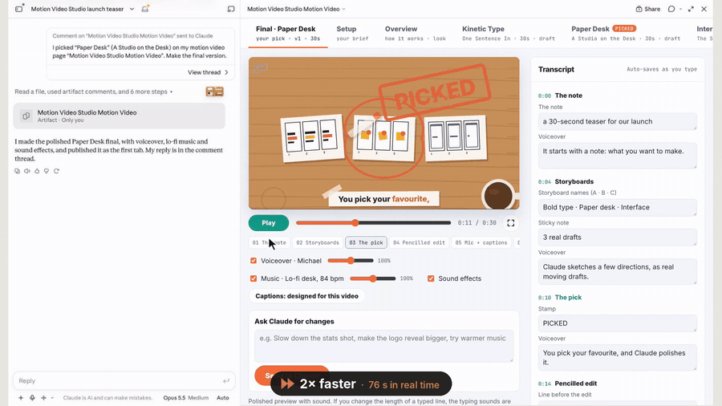

# Motion Video Studio

**A Claude skill that turns a brief into a finished motion-design video.** You describe what you want, Claude builds real draft videos to compare, you pick one and edit the words live, and it renders a full HD MP4 with music, voiceover and captions. It all happens in one live page next to the chat.

## Demo

https://github.com/user-attachments/assets/9f4290e2-9f97-4fbf-9c38-f23fb3f68a26

*The full walkthrough, 3 minutes with sound: setup, real drafts, live edits, voiceover, captions and rendering.*



*Live edits: change a line and the video updates as you type, with no re-render.*

---

## What it does

Type `/motion-video-studio` in Claude and say what the video is for: a brand film, product launch, explainer, talk teaser, lesson, anything. Claude opens a studio page beside the chat and you take it from there.

1. **Setup.** Describe the video, add a website, paste content or attach files, then choose:
   - the length and the shape (landscape 16:9, portrait 9:16, or both);
   - whether to compare storyboards first or skip them and get one finished video;
   - a style for each direction: one of 48 styles, your own description, or Claude's choice;
   - a music mood and sound effects;
   - a voiceover: free voices with a ▶ sample for each, or your own paid voice service;
   - captions, and the language of the words (English, Urdu script, Roman Urdu or mixed).
2. **Real drafts, side by side.** Every direction is a draft video playing at real timing, not a static storyboard. Each one has its own tab.
3. **Live edits.** Every word on screen is listed beside the player. Change a line and the video updates instantly. Edits save automatically.
4. **Pick and polish.** Pick a direction and Claude builds the polished final, keeping your edits. Ask for bigger changes in the page and Claude publishes the next version to the same tab.
5. **Sound, voice and captions.** Music is composed around the shots, sound effects are tied to on-screen moments, and the music dips under the voiceover. There are volume sliders, and captions follow the voice word by word. A gallery of 150+ caption styles has live previews, and you can move captions anywhere on the video.
6. **Render MP4.** One button encodes the finished video in full HD with sound, right in your browser.

## Highlights

- **Compare directions in motion.** Choosing from moving drafts is much easier than choosing from sketches.
- **No re-render for text changes.** Each frame is a pure function of time and the transcript, so the preview, the browser render and the server render always match.
- **Free voiceover.** Uses [Kokoro](https://github.com/thewh1teagle/kokoro-onnx) voices that run locally, with 20 voices across American, British and Hindi/Urdu accents. You can also bring your own voice service or recordings.
- **Multilingual captions.** English, Urdu in its own script (Noto Nastaliq), Roman Urdu, or a mix.
- **A high quality bar.** The skill tells Claude to give every video depth, dimension, texture and a signature "wow" moment, and to check each frame before showing it.

## Install

**Claude (claude.ai and the desktop app):** download this repo as a ZIP (or zip the folder yourself) and add it as a skill in Claude's settings.

**Claude Code:**

```bash
git clone https://github.com/Aimen-Khalid/motion-video-studio ~/.claude/skills/motion-video-studio
```

Then ask for a video, for example: *"/motion-video-studio make a 30-second launch teaser for our new app"*.

### Requirements

Claude installs what's missing the first time the skill runs:

- Python 3 with `playwright` (Chromium), `numpy`, `scipy`, `fonttools`, `brotli`
- Node.js and `ffmpeg`
- For voiceover: `kokoro-onnx` and `soundfile` (the free voice model, about 120 MB, downloads on first use)

## How it's organised

```
SKILL.md                 the workflow Claude follows
assets/
  page.src.html          the live studio page (setup, drafts, final, editor, render)
  engine-core.js         the animation engine: frames as SVG from (time, texts)
  captions/              150+ caption templates and their fonts (with licences)
  voices/                short samples of each free voice
scripts/
  new_project.py         start a project
  build_page.py          build the studio page from the boards
  audio.py               compose music and sound effects around the shots
  voiceover.py           voice the narration and time every word
  render.py              render a board to MP4 on the server
  sheet.py, audit_text.js  contact sheets and on-screen text checks
  extract_brand.py, fonts.py  brand colours, logos and fonts from a website
references/              engine guide, page and data model, style menu, voices, lessons
  example-arbisoft/      a worked example of the mechanics
docs/                    images for this README
```

## Credits

- Voices: [Kokoro](https://huggingface.co/hexgrad/Kokoro-82M) via [kokoro-onnx](https://github.com/thewh1teagle/kokoro-onnx).
- Caption fonts are open-source Google Fonts. Each font's licence is in `assets/captions/fonts/licenses/`.
- Made by [Aimen Khalid](https://github.com/Aimen-Khalid) with Claude.
